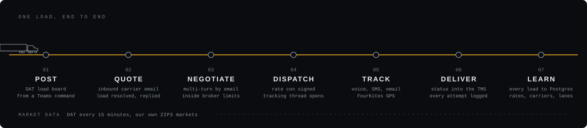

<p align="center">
  
</p>

I build the software that runs a freight brokerage at Fords Fast Freight. Loads get posted, carriers get answered, rates get negotiated, trucks get tracked and the TMS stays current, with people stepping in where judgment is needed. Most of it runs in production every day.

<p align="center">
  
</p>

#### Systems

| | |
|---|---|
| **Load distribution** | Certified DAT integration that publishes freight to the national load board and manages each posting through its life, refreshing it while the load is open. Every posting is tied back to its load, so time to cover and carrier response can be measured. |
| **Carrier sales agent** | Stateful agent on the dispatch inbox. Classifies inbound carrier email, resolves it to a live load and negotiates rate across multi-turn threads within broker-defined bounds, then escalates to a broker at agreement. Behaviour is pinned by around a hundred regression tests drawn from production incidents. |
| **Track and trace** | Event-driven. A signed rate confirmation opens the tracking thread, and a status-driven cadence follows the load to delivery. Idempotent on TMS event IDs and deployed as isolated per-pod instances, each with its own mailbox and datastore. |
| **Voice and GPS check calls** | A voice agent calls drivers and dispatch with real-time speech recognition and an SMS fallback, then writes location and ETA back to the TMS. A parallel service turns live telematics into map-pinned check calls every 30 minutes. |
| **Market data** | Append-only time series of supply and demand across the major US freight markets, sampled every 15 minutes: posted loads, posted trucks, load-to-truck ratio and rates. Markets are custom, defined from 3-digit ZIP clusters. |
| **Market intelligence** | Leading-indicator agent over freight news, the event calendar and weather. Flags what is about to move capacity before it reaches the board. |
| **Data platform** | Full ingestion of the TMS into Postgres at line-item depth: lanes, buy and sell rates, stops and charges. Read-only by design. Feeds rate modelling and a company-wide view of carriers by lane. |
| **Document automation** | Mail agent over Microsoft 365 that reads message bodies and OCRs scanned attachments to route documents that rules engines cannot see. |
| **Operations control plane** | One pane over every agent. Entra ID sign-in, invite-only access, pod-scoped tenancy, an audit trail, runtime controls, and a read-only assistant that answers questions over live operational data. |

#### How I build

```
one service per agent      own repo, own deploy, own database
read-only first            write access after a dry run and a human review
incidents become tests     every production failure is pinned so it stays fixed
pods are isolated          one team's configuration cannot break another's
```

#### Stack

```
languages       Python, SQL, PHP
services        FastAPI, asyncio, APScheduler, Postgres
ai              Claude (Anthropic API), LangGraph, LangChain, Deepgram
integrations    DAT, AscendTMS, FourKites, Microsoft Graph, Entra ID, Teams, Vonage
infra           Railway, Docker, GitHub
```

<p align="center">
  <a href="https://www.linkedin.com/in/kashyapakhil25/">LinkedIn</a>
</p>
